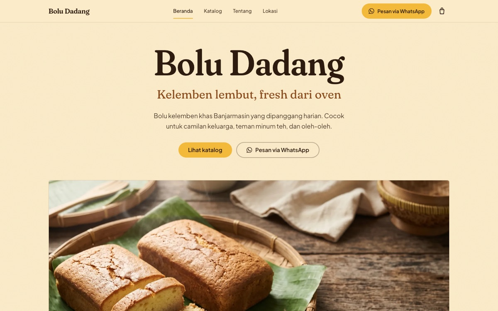
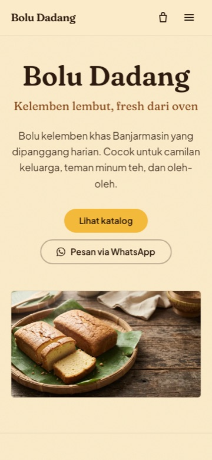

# Bolu Dadang

Landing page + toko online statis untuk **Bolu Dadang**, usaha kue bolu kelemben khas Banjarmasin. Pelanggan bisa melihat katalog, membuka detail produk, menyusun keranjang, lalu mengirim pesanan terstruktur lewat WhatsApp.

<p align="center">
  
  
</p>

<p align="center">
  <a href="https://rahmadahyaweb.github.io/bolu-dadang/"><strong>Lihat situs →</strong></a>
</p>

<p align="center">
  
  
  
  
</p>

---

## Kenapa project ini

Bolu Dadang sebelumnya hanya satu halaman dengan tombol WhatsApp. Sekarang alurnya dibuat seperti toko online: **Beranda → Katalog → Detail Produk → Keranjang → Konfirmasi → WhatsApp**. Tidak ada backend, tidak ada payment gateway — checkout menghasilkan pesan pesanan yang siap dikirim ke penjual.

Struktur dan pola komponen mengacu pada studi kasus e-commerce Cake City di Behance, tetapi **brand, copy, foto, dan identitas visual dibuat sendiri**. Tidak ada aset atau teks milik proyek referensi yang dipakai.

## Fitur

- **Multi-halaman** — Beranda, Katalog, Detail Produk, Keranjang, Checkout, Tentang, Lokasi.
- **Filter katalog** per varian (`?kategori=pandan`) + urut nama.
- **Detail produk** — galeri, deskripsi, accordion info, quantity stepper, cross-sell.
- **Keranjang** — `localStorage`, badge header, ubah qty, hapus, persist setelah refresh.
- **Checkout WhatsApp** — nama/WA/mode wajib; tanggal, alamat, catatan opsional; pesan berisi item × qty.
- **Tanpa harga karangan** — selama harga belum diisi, UI menampilkan “Tanya harga” dan total “Dihitung via WhatsApp”.
- **SEO per halaman** — title/description unik, canonical, Open Graph, JSON-LD `LocalBusiness`, `Product`, `BreadcrumbList`, `FAQPage`.
- **Aksesibilitas** — kontras AA, focus ring, label form, `aria-live` untuk keranjang, keyboard/Esc, reduced-motion.
- **Responsif** — mobile 390px, tablet 768px, desktop 1440px; drawer keranjang menjadi bottom sheet di mobile.
- **Deploy statis** — GitHub Pages via GitHub Actions, base path otomatis.

## Halaman

| Route | Isi |
| --- | --- |
| `/` | Hero, teaser katalog, tentang, nilai, testimoni, FAQ, kontak |
| `/katalog` | Semua produk + filter kategori + urut nama |
| `/produk/[slug]` | Detail produk, galeri, info, qty, tambah ke keranjang |
| `/keranjang` | Keranjang penuh, ubah qty, hapus |
| `/checkout` | Konfirmasi pesanan → pesan WhatsApp |
| `/tentang` | Cerita dan nilai usaha |
| `/lokasi` | Alamat, jam buka, peta OpenStreetMap, ambil/kirim |

## Stack

- [Astro 7](https://astro.build) — static site, `astro:assets` untuk optimasi gambar.
- [Tailwind CSS 4](https://tailwindcss.com) — via `@tailwindcss/vite`.
- Fraunces + Plus Jakarta Sans — font self-hosted (`@fontsource-variable`).
- Vanilla JavaScript — cart, drawer, galeri, carousel, checkout (< 15 KB gzip).
- Tanpa framework client, tanpa database, tanpa API key.

## Menjalankan lokal

```bash
git clone https://github.com/RahmadahyaWeb/bolu-dadang.git
cd bolu-dadang
npm install
npm run dev       # http://localhost:4321/bolu-dadang/
```

Perintah lain:

```bash
npm run build     # output statis ke dist/
npm run preview   # preview hasil build
npm run verify    # validasi 10 halaman hasil build
npm test          # unit test cart, order, wa
```

## Struktur

```text
.
├─ src/
│  ├─ components/        # Header, Footer, CartDrawer, ProductCard, dll.
│  ├─ data/
│  │  ├─ business.ts     # kontak, alamat, jam, FAQ, testimoni
│  │  └─ catalog.ts      # produk, kategori, detail
│  ├─ layouts/Layout.astro
│  ├─ lib/
│  │  ├─ cart.ts         # state keranjang + localStorage
│  │  ├─ order.ts        # pembentuk pesan WhatsApp
│  │  ├─ path.ts         # helper base path GitHub Pages
│  │  └─ wa.ts           # normalisasi nomor + deep link
│  ├─ pages/             # route
│  ├─ scripts/site.ts    # interaksi client
│  └─ styles/global.css  # token warna, tipografi, motion
├─ tests/                # node:test
├─ scripts/verify.mjs    # pemeriksa artefak build
├─ docs/                 # screenshot README + prompt gambar
└─ .github/workflows/    # deploy GitHub Pages
```

## Data & konten

Semua fakta bisnis terpusat:

- `src/data/business.ts` — nama, nomor WhatsApp, alamat, jam, FAQ, testimoni.
- `src/data/catalog.ts` — produk, kategori, deskripsi, foto.

Yang masih perlu diisi pemilik (ditandai `TODO(owner)`):

- [ ] `priceFrom` per produk — selama kosong, harga tidak ditampilkan.
- [ ] `ingredients`, `allergens`, `storage`, `packaging` — hanya jika sudah dikonfirmasi.
- [ ] `weight`, `servings` bila tersedia.
- [ ] Ganti 3 testimoni contoh dengan ulasan asli, lalu set `testimonialsAreExamples: false`.
- [ ] Konfirmasi nomor WhatsApp dan jam buka.

> **Penting:** foto di repo ini masih ilustrasi AI (Gemini/Nano Banana), bukan foto produk asli. Ganti sebelum publikasi. Lihat [`CREDITS.md`](./CREDITS.md) dan [`docs/image-prompts.md`](./docs/image-prompts.md).

## Keranjang & checkout

1. Tambah produk dari PDP → cart drawer terbuka, badge header bertambah.
2. Item disimpan di `localStorage` (`bolu-cart-v1`), bertahan setelah refresh.
3. Qty 1–20; qty 0 menghapus item.
4. Subtotal hanya muncul jika semua produk punya `priceFrom`; jika tidak, “Dihitung via WhatsApp”.
5. Checkout mewajibkan nama, nomor WA, dan mode ambil/kirim.
6. Tombol “Kirim pesanan via WhatsApp” membentuk pesan:

```text
Halo Bolu Dadang, saya mau pesan:
- Kelemben Pandan × 2
- Kelemben Original × 1

Mode: Ambil di tempat
Tanggal: 2026-11-08
Nama: Rina
WA: 0812...
Catatan: potong jadi 8 bagian

Mohon konfirmasi harga dan ketersediaan.
```

Tidak ada data pelanggan yang dikirim ke server — semuanya dirangkai di browser.

## Deploy

Deploy otomatis ke GitHub Pages lewat [`.github/workflows/deploy.yml`](./.github/workflows/deploy.yml) setiap push ke `main`.

1. Buka **Settings → Pages** di repo GitHub.
2. Pilih **Source: GitHub Actions**.
3. Push ke `main`. Workflow akan build dan deploy.
4. Situs: **https://rahmadahyaweb.github.io/bolu-dadang/**

`astro.config.mjs` membaca `GITHUB_REPOSITORY` dan `GITHUB_REPOSITORY_OWNER` dari Actions, sehingga `site` dan `base` (`/bolu-dadang`) otomatis. Link internal memakai helper `src/lib/path.ts`.

Untuk custom domain: set `base: "/"`, ubah `site`, dan tambahkan `public/CNAME`.

## Verifikasi

```bash
npm run build
npm run verify
npm test
```

`verify` memeriksa 10 halaman: satu `<h1>`, title/description/canonical/OG, JSON-LD valid, link internal memakai base, tautan `wa.me/62` + `?text=`, aset ada, dan tidak ada `TODO`/`lorem`.

## Kredit

- Foto placeholder: ilustrasi AI (Gemini/Nano Banana) — lihat [`CREDITS.md`](./CREDITS.md).
- Peta: © [OpenStreetMap contributors](https://www.openstreetmap.org/copyright).
- Referensi struktur: [Cake City — Yana Sashkova](https://www.behance.net/gallery/172527335/E-commerceUXUICake-CityWeb-Design). Tidak ada aset, brand, atau copy yang disalin.
